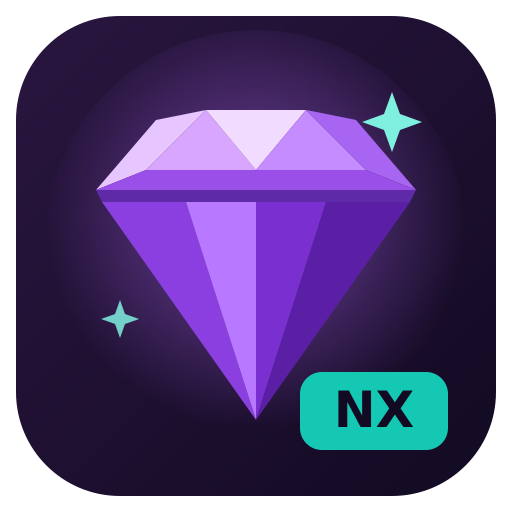

<!--
# SPDX-FileCopyrightText: Copyright 2025 Eden Emulator Project
# SPDX-License-Identifier: GPL-3.0-or-later

# SPDX-FileCopyrightText: 2018 yuzu Emulator Project
# SPDX-License-Identifier: GPL-2.0-or-later
-->

  

<h1 align="center">AghathNX</h1>

<i>Agatha das pedras raras 💎</i>

O AghathNX é um emulador experimental e de código aberto de **Nintendo Switch** e **Switch 2**, escrito em C++. Ele é um fork do **[Fritchii](https://github.com/Frizti/Fritchii) v5.8.4**, de Frizti, que por sua vez vem do Lichii, do Eglantine, do Eden e do yuzu. Por isso ele traz tudo o que o Fritchii v5.8.4 já fazia, como o desempenho e as correções visuais de Zelda: Ocarina of Time, o DLSS por jogo e a janela de Saves.

Este é um projeto independente. Ele não é afiliado à Nintendo nem é uma versão oficial dos projetos de origem.

## Download e uso

As versões publicadas ficam na página **Releases** deste repositório. No Windows, extraia o zip inteiro e rode o **aghathnx.exe**. Não baixe os arquivos "Source code": eles não contêm o emulador.

Jogos, chaves (keys) e firmware **não** vêm incluídos. Use só arquivos que você obteve legalmente.

### Saves e configurações

O AghathNX guarda seus dados em uma pasta própria: `%APPDATA%\aghathnx` no Windows, e as pastas `aghathnx` em `$XDG_DATA_HOME`, `$XDG_CONFIG_HOME` e `$XDG_CACHE_HOME` no Linux e no macOS. Uma pasta portátil `user/` ao lado do executável continua tendo prioridade.

Na primeira vez que você abre o AghathNX, ele oferece copiar seu perfil de outro emulador: **Fritchii**, Eden, Lichii, yuzu, suyu, sudachi ou citron. Ele copia configurações, keys, mods e saves. Os caches não são copiados, então os shaders são preparados de novo uma vez. A pasta antiga nunca é alterada. Depois, você também pode copiar pelo menu **Ajuda > Copy Data from Fritchii, Eden or Lichii...**.

Por enquanto o AghathNX não se atualiza sozinho. As novas versões saem na página de Releases.

## Compilando

Para compilar no **GitHub**, abra a aba **Actions**, escolha **AghathNX Windows build** e clique em **Run workflow**. O zip fica anexado ao resultado da execução. Se você criar uma tag `aghathnx-vX.Y`, o zip também é publicado como pre-release. O número da versão fica em `dist/frizti_version.txt`.

Para compilar no **PC**, siga o [guia de compilação](docs/Build.md). O alvo da interface continua se chamando `yuzu`, e o executável gerado é o `aghathnx.exe` (ou `aghathnx` no Linux e no macOS).

## Créditos e licença

O AghathNX é software livre sob a **GPL-3.0-or-later** (veja [LICENSE.txt](LICENSE.txt)). Partes herdadas também seguem as licenças que aparecem em cada arquivo e na pasta [LICENSES](LICENSES).

Este projeto só existe graças ao trabalho de:
- **Frizti**, pelo [Fritchii](https://github.com/Frizti/Fritchii);
- **zortos293** e os contribuidores do Lichii;
- os projetos **Eglantine** (de Camille LaVey), **Eden**, **yuzu** e **Sudachi** e todos os seus contribuidores.

Os avisos de copyright originais foram mantidos. As mudanças de identidade do AghathNX estão descritas em [docs/aghathnx/BRANDING.md](docs/aghathnx/BRANDING.md).
